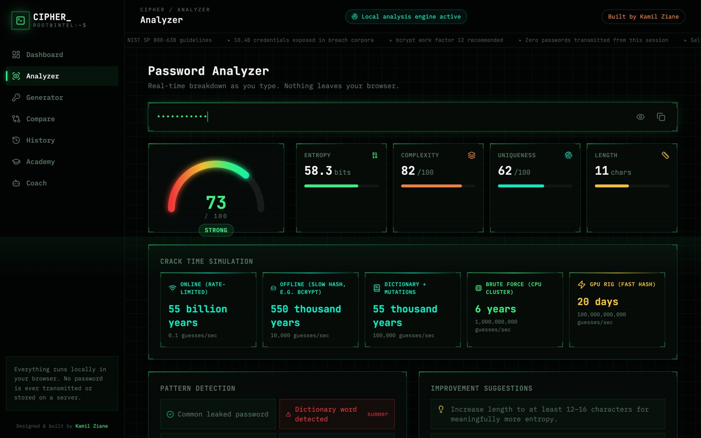

# CIPHER — Password Intelligence Dashboard

A password analyzer that explains its result: strength score, entropy, detected
patterns and estimated crack times across different attack scenarios. It also
has a secure generator and short lessons. Everything runs locally; no password
is ever sent anywhere.

**Live demo:** https://cipherziane.netlify.app/

## Why I built it

Most strength meters show a coloured bar and nothing else. They don't say *why*
`Summer2024!` is weak even though it has a capital, a number and a symbol. And
typing a real password into a random website to test it is a risk in itself.
CIPHER explains the score and never transmits what you type.

## What it does

- **Analyzer:** score, entropy in bits, complexity, uniqueness and length.
- **Pattern detection:** dictionary words, keyboard walks (`qwerty`),
  sequences (`1234`), repeats, and common leaked passwords.
- **Crack-time simulation** for five attackers, from a rate-limited online login
  (0.1 guesses/s) to a GPU rig against a fast hash (100 billion guesses/s). It
  shows why the same password can be "safe" online and broken in days offline.
- **Generator** using the Web Crypto API (`crypto.getRandomValues`), not
  `Math.random`.
- **Compare** two passwords side by side, plus a local **history**.
- **Academy:** short lessons on entropy, brute force vs dictionary attacks,
  hashing, salting and rainbow tables.
- **Coach:** answers questions using the analysis results (score, patterns),
  never the password itself.

## Limitations

- Entropy is estimated from the character set and length, then reduced for the
  patterns it detects. That's a heuristic, not a measurement. Libraries like
  `zxcvbn` model real attacker behaviour more closely.
- The leaked-password check uses a small built-in list. A real check would use
  the Have I Been Pwned k-anonymity API (sending only the first 5 characters of
  the SHA-1 hash).
- The generator picks characters with `random32 % charsetLength`. That
  introduces a very small modulo bias; rejection sampling would remove it.
- The coach is rule-based. It doesn't use a language model.

## About this repository

This repo contains the **production build** (`index.html`, a single
self-contained file built with React, Tailwind CSS and Recharts). Open it
directly in a browser; there's nothing to install.

---

Built by [Kamil Ziane](https://kamilziane.netlify.app/).
